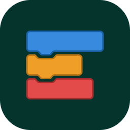

<div align="center">



# ASMacro

**Build macros as block programs. Run them as real mouse and keyboard input.**

[](https://github.com/AsmekYT/ASMacro/releases/latest)
[](https://github.com/AsmekYT/ASMacro/releases)
[](https://github.com/AsmekYT/ASMacro/actions/workflows/ci.yml)
[](https://github.com/AsmekYT/ASMacro/stargazers)
[](LICENSE)
<br>
[](#-install)
[](https://tauri.app)
[](https://www.typescriptlang.org)
[](https://www.rust-lang.org)
[](https://developers.google.com/blockly)

<br>

[](https://github.com/AsmekYT/ASMacro/releases/latest)
[](https://github.com/AsmekYT/ASMacro/releases/latest)

[](https://discord.gg/tgPdKpavph)
[](https://ko-fi.com/asmekyt)

<br>

[Features](#-features) · [Install](#-install) · [Hotkeys](#%EF%B8%8F-hotkeys) · [Build](#%EF%B8%8F-building-from-source) · [Translations](#-translations) · [Community](#-community) · [License](#-license)

</div>

---

## ✨ Features

| | |
|---|---|
| **Block editor** | Macros are Blockly programs: clicks, keys, text, waits, loops, variables. |
| **Screen conditions** | Image match, color match, motion in a region, OCR. |
| **Autoclicker** | Separate from macros, with click points pinned to a specific screen. |
| **Humanization** | Optional jitter on cursor paths and timing. |
| **Hotkeys** | Start/stop per macro, plus a panic key that kills whatever is running. |
| **Updates** | Signed, pulled from GitHub Releases. |
| **Offline** | No accounts, no telemetry. |

## 📦 Install

Download from [Releases](https://github.com/AsmekYT/ASMacro/releases/latest).

| System | Package |
|---|---|
| 🪟 Windows 10/11 | `ASMacro_x.y.z_x64-setup.exe` |
|  Debian /  Ubuntu | `ASMacro_x.y.z_amd64.deb` |
|  Fedora / RHEL | `ASMacro-x.y.z-1.x86_64.rpm` |
|  Other Linux | `ASMacro_x.y.z_amd64.AppImage` |

> [!NOTE]
> The Windows installer isn't code-signed, so SmartScreen will complain the
> first time. **More info → Run anyway.**

### 🐧 Linux setup

The `.deb` and `.rpm` install a udev rule for `/dev/uinput`. Reading input
devices still needs the `input` group:

```sh
sudo usermod -aG input $USER
```

Log out and back in. If something is still missing, Settings will say what.

> [!TIP]
> The AppImage can't install the udev rule and doesn't bundle tesseract, so use
> a package if your distro has one.

## ⌨️ Hotkeys

The autoclicker and the panic key use a low-level input hook and work
everywhere, Wayland included.

Macro start/stop and the coordinate picker go through the desktop's global
shortcut API. Native Wayland doesn't have one, so there you use the tray menu
or the buttons in the app. Windows and X11 are unaffected.

<details>
<summary><b>🌊 Wayland limitations</b> — GNOME and KDE default to Wayland. On Xorg, skip this.</summary>

<br>

- **Cursor position is estimated.** No portal exposes it, so it drifts over
  time. Set a panic key.
- **Screen capture needs a portal.** You grant it once. Without a portal
  backend there's no capture at all. This is the least-tested part of the
  Linux port, so if a vision block fails, check Settings and then
  [open an issue](https://github.com/AsmekYT/ASMacro/issues) with your
  compositor and portal backend.
- **Unicode typing needs the keyboard layout,** which Wayland hides from
  background apps. ASMacro falls back to `XKB_DEFAULT_*` or US and fails with
  an error instead of typing the wrong character. X11 reads the real layout,
  AltGr included.

</details>

## 🛠️ Building from source

Node 22+ and stable Rust.

```sh
npm install
npm run tauri dev
npm run tauri build
npm test
```

<details>
<summary><b>Linux dependencies</b></summary>

```sh
# Debian/Ubuntu
sudo apt install libwebkit2gtk-4.1-dev libgtk-3-dev \
  libayatana-appindicator3-dev librsvg2-dev patchelf \
  libxkbcommon-dev \
  pkg-config build-essential tesseract-ocr tesseract-ocr-eng

# Fedora/RHEL
sudo dnf install webkit2gtk4.1-devel gtk3-devel libappindicator-gtk3-devel \
  librsvg2-devel openssl-devel libxkbcommon-devel \
  tesseract tesseract-langpack-eng
```

</details>

## 🌍 Translations

One JSON file per language, tray menu and system dialogs included:

```json
{
  "language": { "code": "fr", "name": "Français", "match": ["fr"] },
  "strings": { "panel.editor": "Éditeur", "...": "..." }
}
```

| Field | |
|---|---|
| `code` | Stored in settings. Reusing an existing code (e.g. `pl`) overrides its strings. |
| `name` | Shown in Settings → Language. |
| `match` | Locale prefixes for Auto mode. Defaults to `code`. |
| `strings` | Start from [`en.json`](src/i18n/locales/en.json). Keep `{placeholders}` and `%1` slots. Missing keys fall back to English. |

To try one without building, put it in `%APPDATA%\me.asmek.asmacro\locales`
(Windows) or `~/.config/me.asmek.asmacro/locales` (Linux) and restart. To ship
it, add it to `src/i18n/locales/`; `npm test` checks for missing keys.

## 🤝 Community

Bugs and ideas go to [Issues](https://github.com/AsmekYT/ASMacro/issues) or
[Discord](https://discord.gg/tgPdKpavph). Before a pull request, run `npm test`
and `cargo clippy --manifest-path src-tauri/Cargo.toml`.

If it saves you time, a star helps, and so does a
[coffee](https://ko-fi.com/asmekyt) ☕.

## 📄 License

[AGPL-3.0](LICENSE) with the [Commons Clause](https://commonsclause.com/).

You can use, modify and share it. If you distribute a modified version or run
it as a network service, you publish the source under the same terms. You
can't sell it, or a service that mostly consists of it.

That makes ASMacro source-available, not OSI open source. For a commercial
license, open an issue.

---

<div align="center">

[](https://star-history.com/#AsmekYT/ASMacro&Date)

<sub>Made with ❤️ by <a href="https://github.com/AsmekYT">Asmek</a></sub>

</div>
